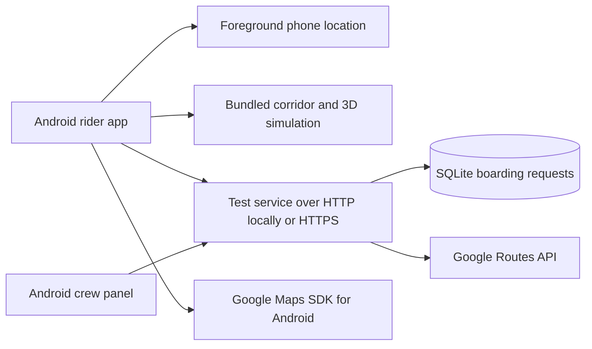

# VozRuta | WFEO Challenge 1

VozRuta helps people plan public-transport trips and ask for support before boarding. Huánuco–Ambo is the initial pilot corridor. Riders can use voice, touch, or text and can ask for specific support, including a spoken guide or a ramp and wheelchair securement.

[WFEO Inclusive Mobility challenge](https://worldengineeringday.net/hackathon/2027-challenge-1/)

## Engineering design

- **Rider experience.** The Android app presents the boarding point, alighting point, scheduled time and fare when supplied. All actionable information also appears in text. The phone reads instructions and announcements in Spanish if a suitable voice is installed. Global itinerary coverage follows the provider's data for each place.
- **Boarding coordination.** The rider sees the support and trip fields before sending them. The test server creates a single request from each request ID, then accepts one valid stage transition at a time. The crew reviews the request and confirms the approach, ramp deployment, assistance, departure and arrival.
- **Road safety.** A driver secures the bus before the attendant directs boarding. The attendant verifies the wheelchair securement or guides the rider to a seat before giving the all-clear. The pilot must verify the waiting area, curb clearance, lighting, pedestrian crossings, gradients and ramp landing. The app identifies unsurveyed points and reports uncertainty about route data.
- **Affordability.** Display fare before the trip when available and flag missing fare data. The test corridor shows illustrative fares for shorter and longer trips. A partner-operated pilot would measure actual fares and rider costs, including any feeder trips, and test a no-surcharge policy for boarding support.
- **Underserved areas.** A bundled route and text commands keep the pilot demonstrable with limited connectivity. In a live deployment, local operators could publish signed, versioned stop and timetable packages and offer a dispatch phone line. Where coverage data is unavailable, the app states the gap so that pilots can prioritize data collection and feeder connections.

## Feasibility and cost model

Start with one operator and two or three surveyed stops before attempting the full corridor. Co-design the boarding protocol with blind and low-vision riders, wheelchair users, caregivers, crews and local officials. Use an existing accessible bus if available. Purchase or retrofit costs require fleet assessment and local quotes.

| Cost item | Illustrative planning assumption | How the pilot will validate it |
|---|---|---|
| Cloud and APIs | US$30–150/month for a small test environment, including contingency. This is a budget assumption. | Record map loads, routes and requests per trip and meter the provider account. |
| Inclusion attendant | S/ 120 per staffed shift as a budgeting assumption | Obtain local fully loaded labor cost and account for training, relief and working hours. |
| Device per bus | S/ 800 for a phone and mount as a budget assumption | Obtain vendor quotes and check charging, visibility and mounting clearance. |
| Site survey | 2 people × 2 days × S/ 130/day = S/ 520 as a planning example | Inspect both directions, barriers and approach path in daylight and after dark. |
| Bus adaptation | Separate quote for ramp, anchorage and inspection | Confirm compatibility, load ratings, maintainability, spare parts and certification. |

Test fare sensitivity using incremental operating cost per staffed shift divided by completed boardings. For example, an illustrative S/ 120 shift spread over 40 boardings is S/ 3 per boarding, before vehicle, training or technology costs. The same shift at 20 boardings costs S/ 6 per boarding. Use the pilot results to decide which portion is covered through operator budgets, fare revenue or municipal funding.

Assign one operator to update timetables and verify stop reports. Set maintenance routines for ramp inspection, anchor checks, voice device updates and review of failed requests. For a deployment, give each rider and crew an account with role-based access and erase old support requests on a defined schedule. Vehicle positions, transit accessibility, rider accounts and safety audits require further field integration.

## Small prototype and measurement plan

Demonstrate one trip by typing **Ir a UNHEVAL**, choosing the wheelchair profile, submitting a boarding request and advancing the 3D bus through arrival and boarding. Repeat with the guide profile and show the equivalent text instructions. Use an itinerary from the global search only where the transit provider supplies data.

Record completion rate with and without TalkBack, successful boarding requests, operator acknowledgement latency, field-verified stops, fare visibility and unserved trip queries. Establish a manual baseline before setting targets. The 3D bus is an engineering concept illustration. It does not establish ramp rating, ride quality or safe boarding conditions.

Success on the first pilot means a repeatable rider-to-crew handoff at surveyed stops and a cost per assisted trip that the operator can explain. Transfer to other cities depends on local agencies, service data and agreements. A future integration can use [GTFS Schedule](https://gtfs.org/documentation/schedule/reference/) and [GTFS Realtime](https://gtfs.org/documentation/realtime/reference/) feeds for operator timetables and vehicles.
